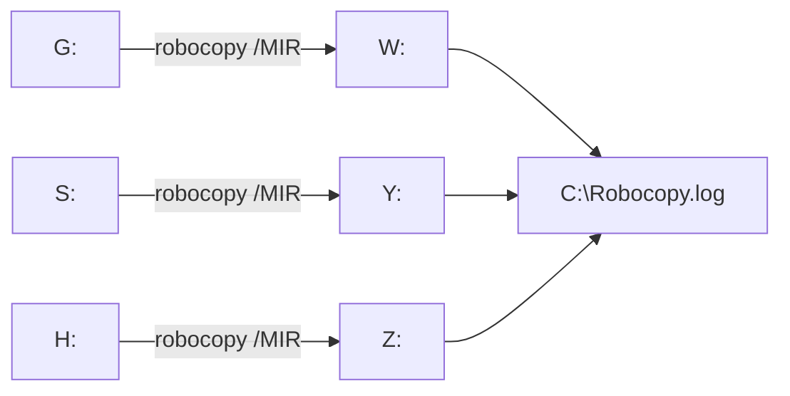

<div align="center">

# 💾 Backup auto (Windows)

**Sauvegarde miroir de plusieurs disques vers leurs disques de secours, en un double-clic, avec Robocopy.**


</div>

---

## ✨ Ce que fait le script

Chaque disque source est **reproduit à l'identique** sur son disque de sauvegarde :

| Source | → | Sauvegarde |
|---|---|---|
| `G:` | → | `W:` |
| `S:` | → | `Y:` |
| `H:` | → | `Z:` |

Seuls les fichiers nouveaux ou modifiés sont copiés : après la première sauvegarde, les suivantes sont rapides.

> ⚠️ **Mode miroir** (`/MIR`) : un fichier supprimé sur la source est **aussi supprimé** sur la sauvegarde. Vérifie bien les lettres de lecteur avant de lancer : une inversion source / destination effacerait tes données.

---

## 🚀 Utilisation

1. Ouvre `Backup Auto.bat` et adapte les lettres (`source` puis `destination`) :
   ```bat
   robocopy G: W: /E /MIR /COPYALL /DCOPY:T /XJ /R:3 /W:5 /V /TEE /LOG:C:\Robocopy.log
   ```
2. Lance-le **en administrateur** (nécessaire pour `/COPYALL`).
3. Le détail est écrit dans `C:\Robocopy.log`.

Pour l'automatiser : Planificateur de tâches Windows › *Créer une tâche* › déclencheur quotidien › action = ce fichier.

---

## ⚙️ Les options utilisées

| Option | Effet |
|---|---|
| `/MIR` (`/E` + purge) | miroir complet, sous-dossiers vides compris |
| `/COPYALL` | conserve données, attributs, dates, sécurité (ACL), propriétaire et audit |
| `/DCOPY:T` | conserve les dates des dossiers |
| `/XJ` | ignore les points de jonction (évite les boucles infinies) |
| `/R:3 /W:5` | 3 nouvelles tentatives, 5 s d'attente sur un fichier verrouillé |
| `/V /TEE /LOG:` | détail à l'écran **et** dans le journal |



---

## 🗂️ Organisation des fichiers

```
Backup-auto-win10/
└── Backup Auto.bat   une ligne robocopy par paire de disques
```

---

## 💻 Compatibilité

| | |
|---|---|
| **Système** | Windows 10 et 11 (Robocopy est intégré à Windows) |
| **Droits** | administrateur |

### Limites
- Le journal est réécrit à chaque ligne : seul le dernier disque y reste (utiliser `/LOG+:` pour cumuler).
- Ce n'est pas un historique de versions : un fichier abîmé sur la source le sera aussi sur la sauvegarde au passage suivant.

---

<div align="center"><sub>Batch · Robocopy · sauvegarde locale</sub></div>
